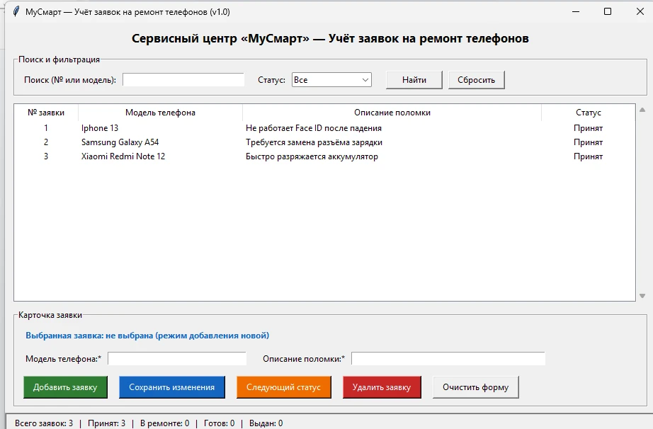
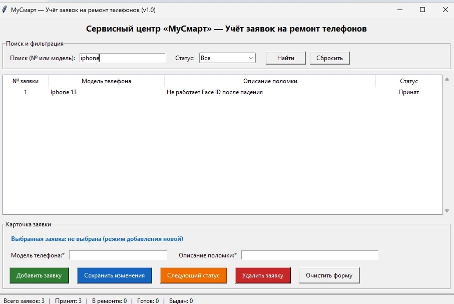

# Документация продукта

**Проект:** Учёт заявок на ремонт телефонов. **Заказчик:** MyСмарт. **Автор:** Кузнецов Иван Евгеньевич, 12ТЭС.
**Версия документа:** 1.0. **Дата:** 19.11.2026.

**Версия приложения:** 1.0. **Статус инструкции:** проверена, 19.11.2026.

## Назначение

Настольное приложение **«MyСмарт — Учёт заявок на ремонт телефонов»** создано для приёмщика заказов и мастера сервисного центра «MyСмарт». Программа заменяет бумажный журнал и позволяет быстро регистрировать принятые смартфоны, находить заявки по номеру или модели, фильтровать их по готовности и контролировать этапы ремонта.

## Установка и запуск

1. **Требования:** ОС Windows 10/11 (или любая ОС с графической оболочкой), установленный **Python 3.11 или новее** со стандартной библиотекой `tkinter`. Внешние пакеты из `pip` не требуются.
2. **Получение проекта:** скачайте или склонируйте репозиторий в удобную папку:
bash
git clone https://github.com
cd student-project-template-kuznivan

3. **Запуск программы:** выполните в терминале из корневой папки проекта:
bash
python src/main.py

4. **Демонстрационные записи для проверки:**
- Модель телефона: `iPhone 13` | Описание поломки: `Не работает Face ID после падения`
- Модель телефона: `Samsung Galaxy A54` | Описание поломки: `Требуется замена разъёма зарядки`
- Модель телефона: `Xiaomi Redmi Note 12` | Описание поломки: `Быстро разряжается аккумулятор`

## Основные сценарии

- **Добавить заявку:** убедитесь, что заявка не выбрана (при необходимости нажмите **«Очистить форму»**), введите текст в обязательные поля **«Модель телефона»** и **«Описание поломки»** и нажмите **«Добавить заявку»**. Новая запись появится в таблице с автоматическим порядковым номером и статусом **«Принят»**.
- **Найти и отфильтровать заявки:** в верхней панели введите номер заявки или часть названия модели в поле **«Поиск (№ или модель)»** и нажмите **«Найти»** (или клавишу `Enter`). Для отбора по этапу ремонта выберите нужное значение в выпадающем списке **«Статус»**. Кнопка **«Сбросить»** возвращает полный список.
- **Изменить данные или статус:** кликните по нужной строке в таблице — её данные загрузятся в нижнюю форму. Отредактируйте модель или поломку и нажмите **«Сохранить изменения»**. Чтобы перевести ремонт на следующий этап по цепочке **«Принят» → «В ремонте» → «Готов» → «Выдан»**, нажмите кнопку **«Следующий статус»**.
- **Удалить заявку:** выберите строку в таблице, нажмите красную кнопку **«Удалить заявку»** и подтвердите действие в диалоговом окне нажатием **«Да»**.
- **Контроль статистики и завершение работы:** в нижней строке состояния отображается актуальное число заявок по каждому статусу. Для завершения работы закройте окно программы крестиком (данные хранятся только в оперативной памяти во время сеанса и при закрытии очищаются).

## Частые вопросы

- **Запись не добавляется, появляется предупреждение.** Проверьте, что заполнены оба обязательных поля: «Модель телефона» и «Описание поломки» (строки из одних пробелов не принимаются).
- **В таблице ничего не найдено.** Проверьте строку поиска и выпадающий список статусов сверху — нажмите кнопку **«Сбросить»**, чтобы снова увидеть все записи.
- **Почему после закрытия программы список снова пустой?** По требованиям первой версии `v1.0` данные хранятся в списке словарей Python в оперативной памяти без использования базы данных.

## Проверка и завершение проекта

- **Проверки:** 19.11.2026, ОС Windows, Python 3.11+, пройдены все 7 приёмочных сценариев (`AT-1` – `AT-7`), результаты зафиксированы в `tests/manual_checks.md`. Открытых ошибок нет.
- **Результат приёмки:** 19.11.2026, проверено на демонстрации, подготовлен выпуск `v1.0` в репозитории на GitHub.
- **Итоги:** реализованы все запланированные функции учёта заявок на Python + Tkinter, оформлена полная документация и журнал ручного тестирования; полезный урок — разбивка работы на короткие спринты и фиксация требований до начала кода помогают избежать лишних переделок.

